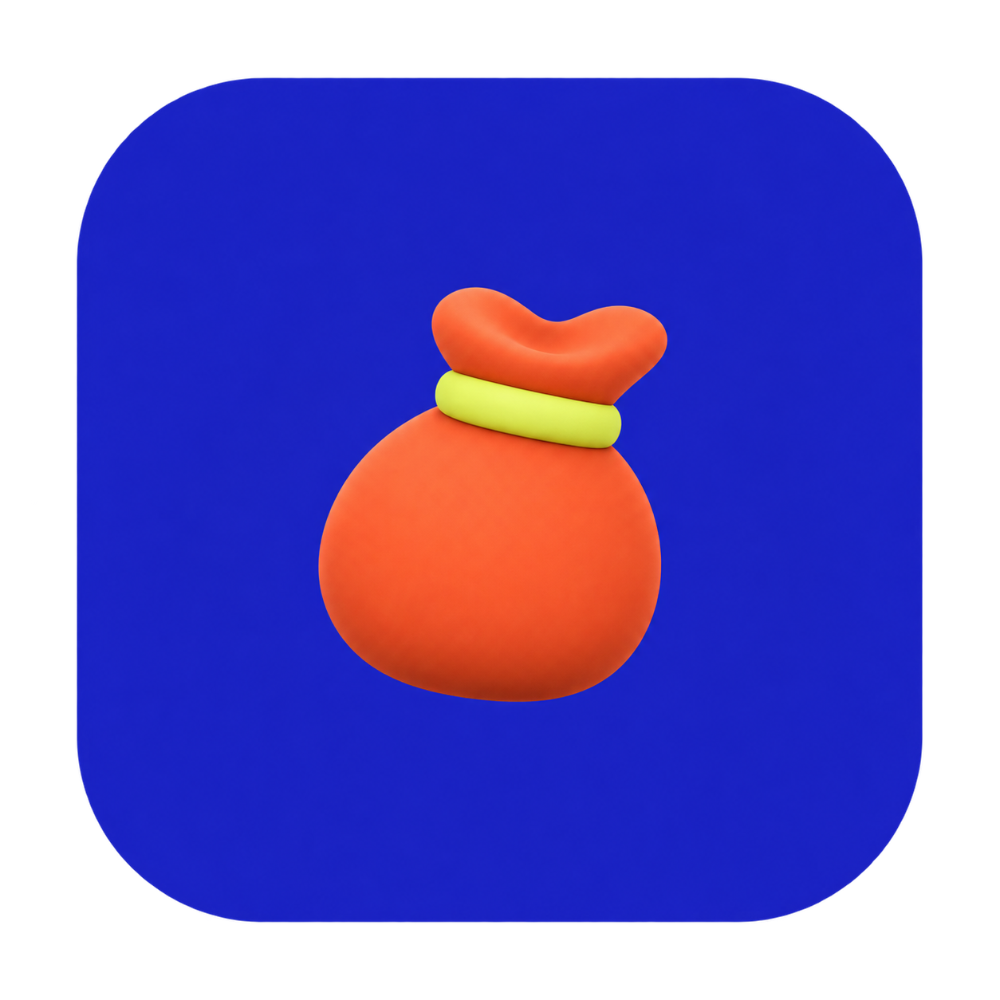
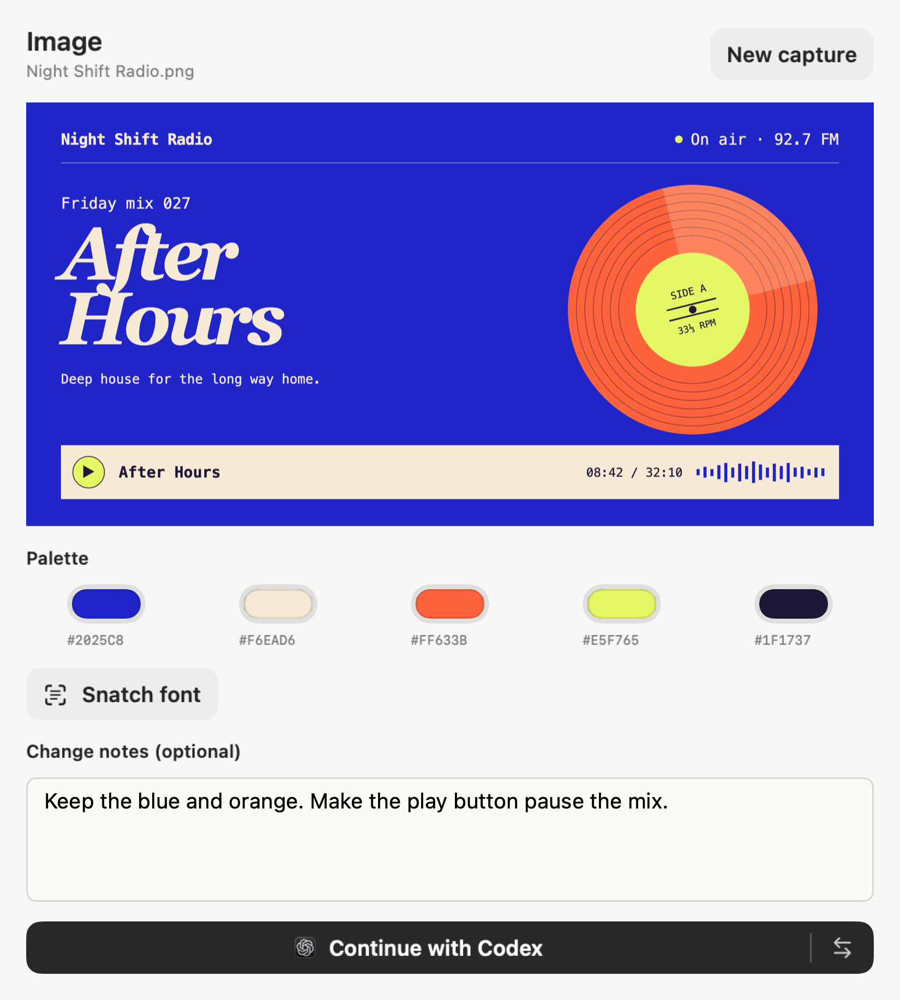

<h1 align="center">Poach</h1>

A lightweight Mac app for the UI you wish you’d made.

<strong><a href="https://github.com/guilopeszw/poach/releases/download/v1.0.0/Poach-arm64.zip">Download for Apple silicon</a></strong>

## Poach with taste

Taste is still your job. When a hover makes you stop and try it again, record it. Poach gives your coding agent the timing, motion, and little details that made you stop.

During native screen recordings, Poach keeps a local, timestamped pointer trace and lets you add notes directly to the video timeline. Share the capture with Codex or Claude so your assistant can inspect the frames, sample-derived click/drag candidates, and your notes while recreating the interaction. Polling can miss or misclassify brief actions, and the trace alone cannot confirm what an action did.

## From screen to chat

1. **Capture the interaction.** Record a screen area, a window, or a full display. In **App window** mode, select the window by its preview. Move Poach wherever it fits on your screen. Poach excludes its own windows and controls from captures. For a selected area, a click-through shadow marks the recording boundary. Press **⌘⇧P** to select an area, then press it again to stop. For a still frame, switch to **Screenshot**, choose what to capture, then click **Take screenshot**. You can also drop in an existing video or image.
2. **Mark the details.** Pause the video and click the comment icon to label what happened at the playhead. Click a comment to return to its frame. Native recordings include a bounded pointer trace with button transitions and drag samples. Adjust the extracted palette and add any instructions that apply to the whole capture.
3. **Build with your assistant.** Choose **Continue with Codex** or **Continue with Claude Code** to open the app and copy the prompt. Paste it into the chat you want to use. Choose **Copy prompt** from the switch menu to copy it without switching apps. The MCP connector lets the assistant read your notes, see representative frames, and request a frame at a specific timestamp. Poach needs no separate AI API key.

**From the menu bar.** Click the pouch icon and choose **Open Poach**, **New Screenshot**, or **New Recording**. The capture shortcuts open Capture with the corresponding type selected. Choose a source before starting. Closing the Poach window leaves the menu bar icon available. Choose **Quit Poach** to exit the app.

**Reuse a handoff.** Bookmark a handoff in the editor and give it a name. In **Favorites**, click its cover to copy a fresh handoff. A favorite keeps the notes, palette, sampled pointer evidence, and up to three reference images totaling 768 KiB or less. To share it with someone, open its menu and choose **Export Poach**. They can open **Favorites → Import** and select the `.poach` file. Use the original capture when you need a frame at another timestamp.

**Match a font from a screenshot.** When Poach detects readable text in a screenshot, **Snatch font** appears below Palette. Drag over a line or pick it from **Choose text line**. Compare the screenshot with editable previews from fonts installed on your Mac. Choose a visual match to include its family and face in your handoff.

**Chrome companion preview.** Pair Chrome in the optional second step of onboarding or in Settings. Poach opens Capture when you pair or skip the step. Select a component in Chrome, then take a screenshot or record its interaction in Poach. The extension sends computed typography, browser events, visible state changes, and available animation timing directly to Poach. Poach automatically includes evidence when the Chrome session overlaps a recording. For screenshots, check the displayed site and choose **Include Chrome evidence** if it matches the image. The preview uses the unpacked extension bundled in Poach.app. [Set up the preview and try the dropzone benchmark](CONTRIBUTING.md#chrome-companion-preview).

In **Settings → Storage**, see how much space Poach uses and choose **Clear unused captures** to remove old recordings, screenshots, and extracted frames. Poach keeps the open edit, media and frames referenced by handoffs that are still available, and your imported originals.

## Install on your Mac

Download the Apple silicon build above, unzip it, and move **Poach.app** to Applications. To update, choose **Check for Updates…** from the Poach menu. If a newer release is available, download it, quit Poach, and replace the app in Applications. Choose the connector for your assistant, then open a new chat.

| Assistant | Install the MCP connector |
| --- | --- |
| [Codex installer](https://github.com/guilopeszw/poach/releases/download/v1.0.0/Poach-Codex.zip) | Unzip and double-click **Install Codex.command**. |
| [Claude Desktop extension](https://github.com/guilopeszw/poach/releases/download/v1.0.0/Poach.mcpb) | Open **Settings → Extensions → Advanced settings → Install Extension**. Select the downloaded file and enable Poach. |

**Requirements.** Native recording and screenshots require macOS 15 or later. On macOS 14 you can import images and videos. Clips can be up to 30 seconds long. Poach records the screen without audio.

Download and first-launch help

Poach includes Node.js and FFmpeg. Verify the downloads with the [SHA-256 checksums](https://github.com/guilopeszw/poach/releases/download/v1.0.0/SHA256SUMS.txt).

Poach 1.0 uses a local development signature and ships without Apple notarization. On first launch, macOS may block it:

1. Try to open **Poach.app** once, then dismiss the warning.
2. Open **System Settings → Privacy & Security**, scroll to Security, and click **Open Anyway** for Poach.
3. Confirm **Open** in the follow-up alert.

After Poach opens, allow it under **Screen & System Audio Recording**, then quit and reopen the app. If capture is refused even though Poach is enabled, first confirm the running copy is in Applications and restart it. Local builds without an Apple Team ID may lose Screen Recording approval after rebuilds; see [Contributing](CONTRIBUTING.md#screen-recording-signing). Apple’s [Open Anyway instructions](https://support.apple.com/en-gb/102445) explain this one-time Gatekeeper override.

Keep Poach in Applications so the connector can find it. After updating Poach or its Claude extension, quit and reopen Claude Desktop to reload the connector. If the handoff button is disabled, open a new chat with the connector enabled. For manual setup, open Poach’s **Settings** and choose **Copy Codex MCP** for the Terminal command or **Copy Claude MCP** for the Claude Desktop configuration.

What does my assistant receive?

Poach analyzes the media on your Mac. During an explicit native screen recording, it samples pointer position and mouse-button state at a nominal 120 Hz; the trace is capped at 5,000 events and reports how many samples fell inside the capture bounds and observed a held button. It does not capture keyboard input or scroll events. Samples outside the captured bounds are flagged and clamped to the capture edge, so raw screen coordinates outside the selected area are not shared. The trace stays local until you explicitly share a handoff. When your assistant reads it, it receives your instructions, timestamped notes, pointer trace, derived click/drag candidates when button events were sampled, palette, and requested frames. If no button events were observed, the copied handoff tells the assistant not to assume clicks or drags. Match action coordinates to frames to identify targets; the trace alone cannot establish what an interaction did. Motion timing and easing are estimates from sampled frames. The handoff includes frames around up to three recent drag releases inside the capture, including a final sample before the next sampled drag or at the end of the clip. Keep recording until the drop animation finishes. Each handoff is stored locally and can be read by its brief ID for 24 hours; sharing another handoff does not replace earlier ones during that window. The latest handoff remains the default when no ID is provided.

[Contributing and local development](CONTRIBUTING.md) · [License](LICENSE)

### Image scale and details

Shared images are captioned with their actual returned dimensions and, when available, stored-source dimensions. `evidence.capture` preserves `widthPx`, `heightPx`, `imageMaxSize` and a nullable `deviceScale`. Native captures additionally record `widthPoints` and `heightPoints`; `deviceScale` is the horizontal ratio of stored pixels to macOS points. Use both dimensions for exact coordinate mapping after encoder rounding. Imports have unknown display scale. Browser CSS pixels are a separate coordinate space.

`poach_read_moment` accepts optional `crop: {x, y, width, height}` in stored-video pixels from the top left and `maxSize` (16–8192, default 1280). Cropping occurs before resizing and never enlarges pixels. The 5 MiB MCP image limit still applies. Native resolution means the stored recording, which may already have been reduced during capture. Old briefs, favorites and `.poach` files remain readable without these optional fields.

Verify a Retina capture, a capture downscaled to 1920 pixels, and an imported file. Check a detail crop and an out-of-bounds crop through MCP, then favorite/export/import/share and verify that dimensions survive.

### Browser measurements at a moment

`poach_read_moment` includes nearby measured browser rectangles, layout/color styles and available animation duration, delay, easing and keyframe offsets. Page viewport and device pixel ratio identify CSS coordinate units. The most recent prior state remains relevant until a later state replaces it. Browser/video alignment is estimated; video-derived timing is approximate, while browser animation timing comes from the page. CSS font stacks remain preferences, not proof of rendered glyph fonts.

When attaching a browser session to a recording, Poach retains observations in the recording interval plus one second of margin and the state active at recording start. Scrolling alone does not consume a state slot. Run `bash scripts/test-browser-evidence.sh` and the MCP package tests to check compatibility, alignment and held states.

### Measured child components

The Chrome companion measures visible descendants at pin time (`components`) and finish (`componentsAtEnd`), preserving relative rectangles, hierarchy, typography, colors and short direct text. Each snapshot keeps at most 40 nodes within six descendant levels; larger trees retain the largest visible areas in document order. Hidden and editable subtrees are excluded. These are two snapshots, not continuous component tracking.

The bridge remains limited to 256 KiB. If necessary it omits only the optional end snapshot; if the remaining evidence is still too large, sending fails with the existing limit message. MCP includes a short component summary and retains the full lists in the brief without repeating them in moment responses. Older extensions and saved files remain compatible.

Run `pnpm test:chrome` (Playwright; system Chrome on macOS, or `CHROME_BIN` pointing to Chrome elsewhere), `bash scripts/test-browser-evidence.sh`, and the MCP package tests. Check hidden/form content, nested trees, more than 40 children, oversized bridge payloads, and favorite/export/import/share preservation. For Playwright-managed Chromium on Linux, run `pnpm exec playwright install chromium` first.
